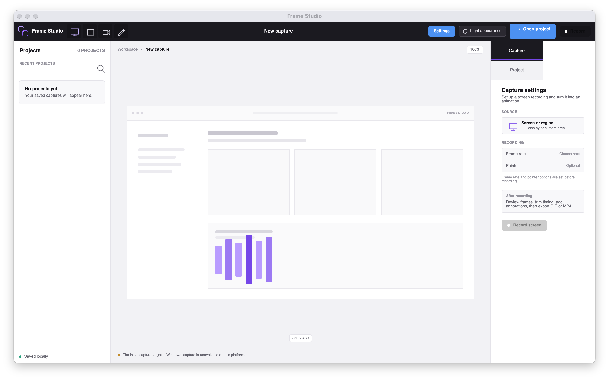
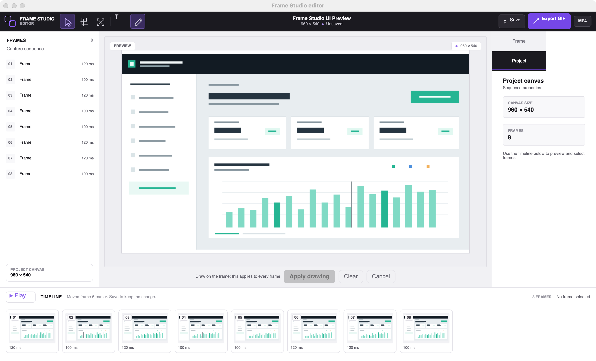

# Frame Studio

**An independent Avalonia port of ScreenToGif, built for the Avalonia Port Challenge.**

Frame Studio is a new desktop workspace for recording, editing, and exporting short screen animations. The migration keeps the original ScreenToGif repository as its functional reference while building a new Avalonia UI and separating reusable logic from Windows-specific services.

This is an independent project. It is not the official ScreenToGif application and is not affiliated with or endorsed by Nicke Manarin or N-Tech.

## Challenge target

The first challenge entry targets **Windows x64** and is positioned as a legacy revival/everyday tool. The Avalonia editor and project/export core also run on macOS, but screen recording is unavailable there; Linux has not been packaged or validated. Frame Studio is not claiming a three-platform capture port, so it should not be entered as a Best Cross-Platform Port in its current state. The Windows Actions artifact linked below is a temporary validation candidate, not the permanent judge-facing download; publish a release asset after the interactive Windows checks pass.

## Current status

The Avalonia app connects Windows screen-region recording to a native `.fsp` project, a frame editor, and GIF/MP4 export. The current home and editor UI use a Jitter-inspired workspace layout adapted for Frame Studio's frame workflow. The Win32/GDI capture backend is implemented and wired into the UI; its native integration tests now pass on a hosted Windows runner, while the interactive app workflow still needs a Windows desktop check. macOS builds and core tests work; screen capture is Windows-only.

| Area | Status |
| --- | --- |
| Avalonia home and editor | Implemented; persistent recent-project list; Jitter-inspired light workspace and editor; current Mac visual review completed, Windows visual comparison still pending |
| Dark and light appearance | Implemented |
| Neutral frame/project foundation | Frame model and compressed `.fsp` archive read/write implemented |
| Platform service contracts | Defined |
| Windows capture | Screen-region capture supports display/area selection, FPS, pointer, pause/stop, and app-window exclusion. Window recording renders the selected app separately from overlapping windows; its pixel-level overlap check passes on hosted Windows. Some hardware-accelerated or protected apps may not render fully. Both capture modes still need an interactive desktop run |
| End-to-end recording workflow | Records frames into `.fsp` projects and opens the editor when recording stops |
| Editor | Frame thumbnails, preview/playback, selection, earlier/later ordering, duplicate/delete, duration edits, drag crop, project-wide resize, all-frame text and freehand overlays, save/discard, and GIF export implemented; keyboard shortcuts cover save, duplicate, reorder, delete, playback, and crop cancel |
| GIF export | Migrated encoder, editor export flow, and completion actions for opening the GIF, showing its folder, or copying its path |
| MP4 export | H.264 MP4 through FFmpeg's `libx264`, with variable frame durations preserved; requires FFmpeg on `PATH` with `libx264` enabled |
| Settings and additional formats | Seven sidebar categories cover local preferences, recording, editor preview looping, GIF palette/loop/size, MP4 quality/size, shortcuts, appearance, and advanced FFmpeg/data-folder tools. GIF dithering, arbitrary output dimensions, APNG, image sequence, PSD, and additional video formats are not migrated |
| Core workflow checks | The current local Release build completes with zero warnings/errors; 48 tests pass and four Windows-only desktop checks skip on macOS. [CI run 38119222955](https://github.com/kris70lesgo/frame-studio/actions/runs/38119222955) passed for PR head `d8bd3605`: 44 deterministic tests (one FFmpeg-dependent skip), all 7 native capture tests, and the Windows package startup smoke. Native coverage includes app-window affinity lifecycle, screen-stream pause/resume/stop, and pixel-accurate isolated-window rendering while another window overlaps it. These checks do not verify the interactive Avalonia workflow or mixed-DPI desktop behavior. Cross-platform checks cover recording → edit → save/reopen → GIF export, editor commands, text/freehand overlays, recovery, project archives, GIF pixels/timing, MP4 timing, and screen-region scaling logic |
| Webcam and sketchboard | Not migrated yet |
| Annotations and video export | Rasterized text and freehand overlays plus H.264 MP4 export are implemented; additional video encoders are not migrated yet |
| Windows platform adapter | Win32 monitor/window enumeration, bounded GDI screen capture, isolated-window rendering, and app-window exclusion implemented; native CI passes. Interactive UI, app-window exclusion in actual recordings, and mixed-DPI validation remain pending |

The original WPF application remains in this repository as the baseline in `GifRecorder.sln`. The new application is in `FrameStudio.sln` and does not reference the WPF UI projects.

## Migration write-up — Windows evidence pending

### Starting point and design

The source baseline is ScreenToGif 2.43.2 at upstream commit `a4d0a67c2131cd048ceec86cd40afc2f1a06f2fd`. I kept its WPF solution intact and built Frame Studio in a separate Avalonia solution with no references to the WPF projects. The WPF application could not run on the macOS development host, so the initial comparison used a source audit and upstream screenshots; same-content Windows captures are still outstanding.

### What moved and what changed

The raw-byte GIF encoder and selected quantizers fit behind a neutral RGBA/pixel-geometry boundary and moved into `FrameStudio.Core`. The median-cut quantizer was independently rewritten from the general algorithm after the previously linked code was found to have no discoverable license; the neural quantizer was omitted because its source has a separate GPLv3 notice. The old model, ViewModels, and UI could not be referenced directly because they carry WPF media, dispatcher, geometry, and input types. Frame Studio replaces those layers with neutral frame/project types, a compressed `.fsp` archive, Avalonia MVVM views, and platform service contracts. Windows recording uses GDI for screen regions and `PrintWindow` for isolated windows.

### Results and limits

The implemented workflow records frames into a project, edits and reorders frames, applies crop/resize/text/freehand changes, saves and reopens projects, and exports GIF or H.264 MP4 through an installed FFmpeg with `libx264`. Local Release verification passes 48 tests, with four Windows-only desktop checks skipped on macOS. Hosted Windows passes 44 deterministic tests (one FFmpeg-dependent skip), all 7 native capture checks, and the packaged-app startup smoke. These checks do not establish the interactive Avalonia recording workflow, app-window exclusion in real recordings, mixed-DPI behavior, or playback of exported files on a user's desktop.

Webcam and sketchboard capture, macOS/Linux capture, APNG, image-sequence and PSD export, GIF dithering, arbitrary export dimensions, and additional video encoders are not implemented. Export scale is currently limited to 50%, 75%, or 100%; MP4 preserves edited frame timing and offers H.264 quality presets. The project retains ScreenToGif's MS-PL notices and license, uses independent branding, and is not the official ScreenToGif application.

### Migration effort and remaining evidence

No active-work timer was kept, so total hands-on effort is unknown. The first app-shell commit (`207a98fb`, 15:48:04 IST) and the Win32 desktop-DC fix (`d453ff46`, 22:07:59 IST) on 3 October are **6 hours 19 minutes 55 seconds** apart in Git committer timestamps. That is elapsed calendar time, not an estimate of labor, and substantial work continued later. I will not infer total effort from those timestamps. Before submission, run the Windows candidate through recording, editing, save/reopen, and export; capture same-content WPF/Avalonia screenshots; and add those results here. The [Windows checklist](docs/WINDOWS_VALIDATION.md) and [results template](docs/WINDOWS_TEST_RESULTS_TEMPLATE.md) track that work. The [source audit](docs/MIGRATION_AUDIT.md) and [journal](docs/MIGRATION.md) contain the detailed technical history.

## UI previews

These macOS captures show the Avalonia home workspace and editor with synthetic sample content. The home capture was refreshed from the current Release build on October 11 and includes Settings. They are useful for reviewing the redesigned UI, but they are not Windows before-and-after comparisons and do not validate native screen recording. The [capture notes](docs/before-after/README.md) describe the remaining Windows screenshot pairs.





Older shell captures remain in the folder as historical UI checks; they predate the current editor workflow.

## Build and run

Requirements: .NET SDK 9.0.318 or a compatible .NET 9 feature-band SDK, with NuGet access for the Avalonia packages.

The Avalonia UI uses the desktop Avalonia stack. The current self-contained Windows x64 candidate is linked in the [Windows validation checklist](docs/WINDOWS_VALIDATION.md); sign in to GitHub with repository read access to download it. The older [Preview 3 release](https://github.com/kris70lesgo/frame-studio/releases/tag/v0.1.0-preview.3) does not contain the current UI. Only Windows has a capture backend. Screen capture requires Windows 10 version 2004 or later because the app excludes its own windows from captured frames. Core project editing and GIF export are platform-neutral. MP4 export calls the user's FFmpeg installation and needs `libx264`; Frame Studio does not redistribute FFmpeg. The full recording workflow must be exercised on Windows before claiming a verified Windows release; no macOS or Linux capture support is claimed.

```sh
dotnet build FrameStudio.sln
dotnet test FrameStudio.sln
dotnet run --project FrameStudio.Avalonia/FrameStudio.Avalonia.csproj
```

To create a self-contained local Windows x64 candidate, run `python3 scripts/package-windows-candidate.py`. It writes the package, README, full license, and SHA-256 checksum under ignored `dist/`. The package remains a development candidate until its Windows runtime checks pass.

`global.json` selects .NET 9 for this migration. The original WPF application targets Windows; this macOS development host can compile it with Windows targeting enabled, but cannot run it.

## Project structure

- `FrameStudio.Avalonia` — Avalonia desktop UI and MVVM.
- `FrameStudio.Core` — framework-neutral pixel geometry and frame/project models.
- `FrameStudio.Platform.Abstractions` — capture, monitor, camera, hotkey, clipboard, notification, permission, and file-dialog contracts.
- `FrameStudio.Platform.Windows` — Win32 monitor/window discovery and bounded GDI screen-region recording sessions.
- `FrameStudio.Tests` — cross-platform core tests.
- `ScreenToGif`, `ScreenToGif.Model`, `ScreenToGif.Native`, `ScreenToGif.Util`, and `ScreenToGif.ViewModel` — original WPF implementation retained as the behavior and migration reference.

See [the source audit](docs/MIGRATION_AUDIT.md) for reusable modules, framework coupling, and the proposed architecture. The [migration journal](docs/MIGRATION.md) records decisions and lessons as the port progresses.

See [the challenge analysis](docs/CHALLENGE_ANALYSIS.md) for the judging criteria, entry requirements, and the schedule used to prioritize migration work.

The current self-contained Windows x64 candidate and its independently verified checksum are recorded in the [Windows validation checklist](docs/WINDOWS_VALIDATION.md). Hosted Windows CI passes the native capture checks and package startup smoke, but the app still needs an interactive Windows launch and capture run before its workflow can be claimed as verified.

## Attribution and license

The source application is [ScreenToGif](https://github.com/NickeManarin/ScreenToGif), created by Nicke Manarin and contributors. Its original source is licensed under the **Microsoft Public License (MS-PL)**. The complete upstream license and required notices are preserved in [`LICENSE.txt`](LICENSE.txt). Source derived from ScreenToGif is distributed under the terms of that license.

The MS-PL does not grant rights to the ScreenToGif name, logo, or other contributor trademarks. Frame Studio uses its own name and visual identity.
